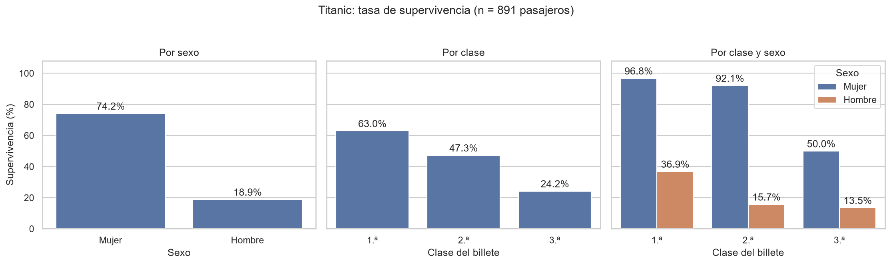
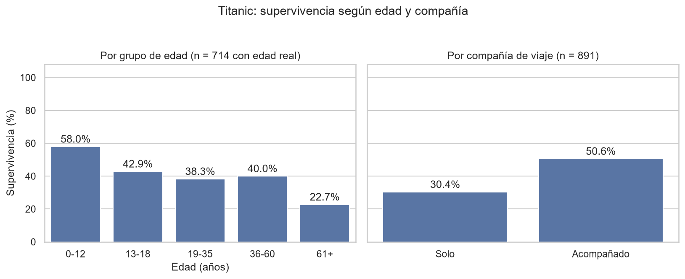

# Titanic: ¿qué factores se asociaron con sobrevivir?

Análisis exploratorio de datos en Python sobre los pasajeros del Titanic, para responder a una pregunta concreta: **¿qué factores (sexo, clase, edad, compañía de viaje y tarifa) se asociaron más con sobrevivir?**

## Datos
- Dataset `titanic` de la librería seaborn: 891 pasajeros y 15 columnas.
- Se carga con `sns.load_dataset("titanic")`, por lo que hace falta conexión a internet la primera vez que se ejecuta.

## Hallazgos principales
Sobrevivió el 38,4 % de los pasajeros.

- **Sexo:** 74,2 % de las mujeres frente al 18,9 % de los hombres.
- **Clase:** 63,0 % en 1.ª, 47,3 % en 2.ª y 24,2 % en 3.ª.
- **Sexo y clase juntos:** más del 90 % de las mujeres de 1.ª y 2.ª clase sobrevivió, frente al 50,0 % de las de 3.ª. Entre los hombres, solo los de 1.ª clase superaron el 20 % (36,9 %).
- **Edad:** los niños de hasta 12 años sobrevivieron más (58,0 %).
- **Viajar solo y tarifa:** la diferencia observada se explica en buena parte por el sexo y la clase. Detalle y cifras en el notebook.




## Limpieza de datos
- Se eliminó la columna `deck` (77,2 % de valores vacíos).
- Los 2 valores vacíos del puerto de embarque se rellenaron con el más frecuente.
- Las edades vacías (19,9 %) se rellenaron con la mediana por clase y sexo para el análisis general. El análisis por edad usa solo las edades reales (714 pasajeros).

## Límites del análisis
- Son asociaciones, no causas: no se miden factores como la ubicación del camarote ni las órdenes de evacuación.
- Algunos grupos son pequeños (por ejemplo, 22 personas de más de 60 años), por lo que sus porcentajes son menos fiables.
- Los datos son una muestra de 891 pasajeros, no todas las personas a bordo.

## Herramientas
Python, pandas, matplotlib, seaborn y Jupyter.

## Cómo ejecutarlo
```
git clone https://github.com/rochabernardo393-sys/titanic-analisis.git
cd titanic-analisis
python -m venv .venv
.venv\Scripts\Activate.ps1
pip install -r requirements.txt
```
Después abre `titanic.ipynb` en VSCode (con la extensión Jupyter) y ejecútalo.
